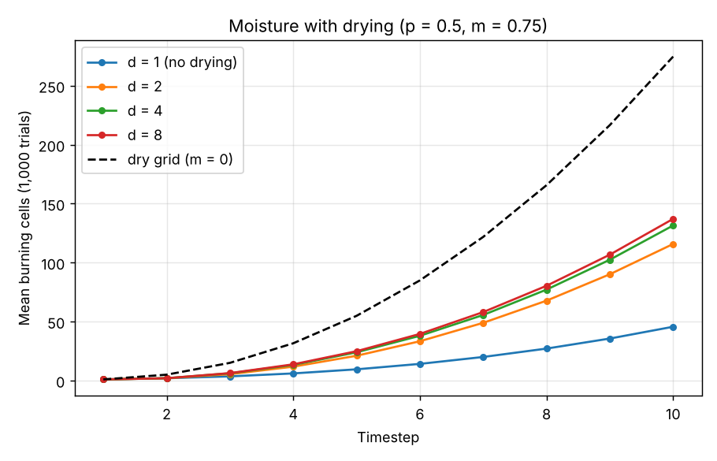
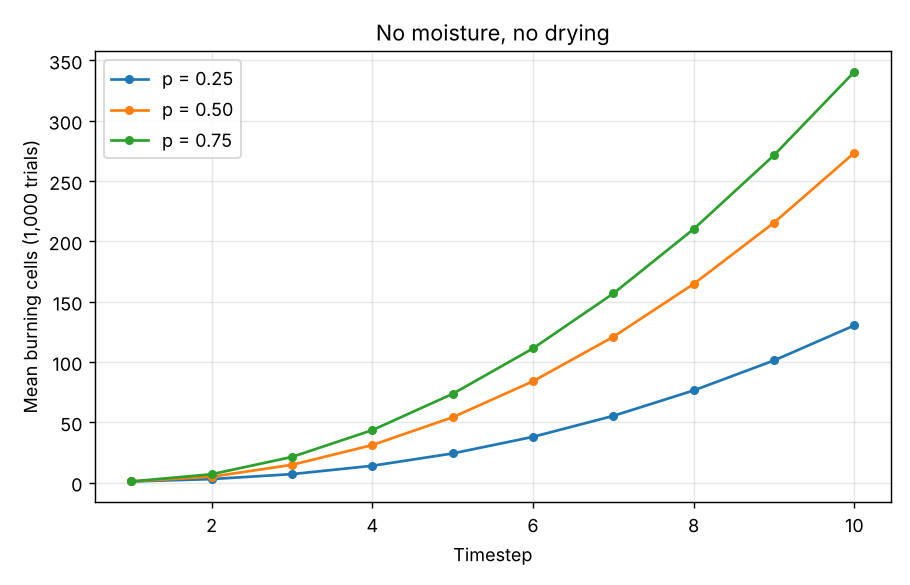
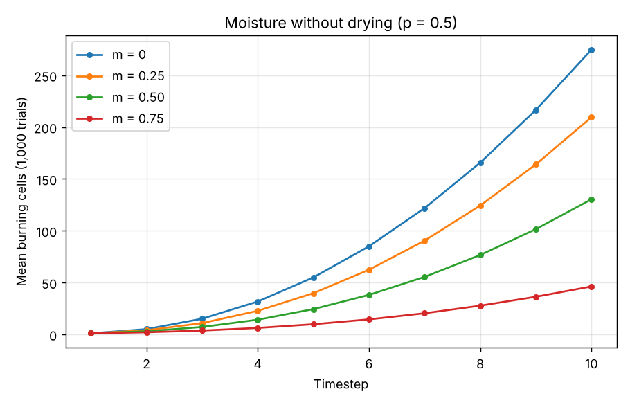

# Modeling How Moisture Affects Wildfire Spread

This project implements a cellular automaton model in MATLAB to simulate wildfire propagation across a grid, with a focus on how environmental moisture and fire-induced drying affect spread dynamics.

The full mathematical background and analysis are in the accompanying paper: **[Modeling How Moisture Affects Wildfire Spread (PDF, March 2024)](Modeling_How_Moisture_Affects_Wildfire_Spread.pdf)**



---

## Project Overview

Wildfire behavior depends on many environmental factors. This model isolates one critical variable — moisture content — to better understand its role in fire propagation.

The simulation models fire spread on a 2D grid where:

- Each cell represents a patch of vegetation.
- Fire begins at a single ignition point (center of the grid).
- Fire spreads probabilistically to adjacent cells.
- Moisture reduces ignition probability.
- Cells that do not ignite experience drying due to nearby heat exposure.

The goal of this project is to explore:

- How ignition probability affects fire growth
- How varying moisture levels slow propagation
- How drying alters long-term fire behavior

---

## Mathematical Model

### Base Ignition Rule

Fire spreads according to a probabilistic rule:

R <= p

Where:
- R is a random number in [0,1]
- p is the ignition probability

If the condition holds, the adjacent cell ignites.

---

### Moisture Adjustment

Moisture is modeled as a scalar m in [0,1]:

- m = 0 → completely dry
- m = 1 → fully saturated

Ignition probability becomes:

p_effective = p(1 - m)

Higher moisture reduces ignition likelihood.

---

### Drying Effect

Cells adjacent to fire that do not ignite experience moisture reduction:

m_(t+1) = m_t / d

Where:
- d is the drying factor
- Larger d means faster drying

---

## Simulation Details

- 20×20 grid with a single fire started in the center
- Fire spreads to the 8 surrounding cells (including diagonals), at most one cell per timestep
- 10 timesteps per simulation
- Each experiment averaged over 1000 trials
- Fire area measured as number of burning cells per timestep

---

## Experiments Conducted

### 1. No Moisture, No Drying
Explores propagation for ignition probabilities:
- 25%
- 50%
- 75%

Result: Higher ignition probability leads to significantly faster and larger spread.

### 2. Moisture Without Drying
Fixed ignition probability p = 0.5  
Moisture levels tested:
- 0
- 0.25
- 0.5
- 0.75

Result: Increasing moisture substantially slows fire growth.

### 3. Moisture With Drying
Fixed:
- p = 0.5
- Moisture = 0.75

Drying factors tested:
- 1 (no drying)
- 2
- 4
- 8

Result:
- Drying accelerates fire growth over time.
- Even strong drying does not fully match the speed of a completely dry grid due to delayed moisture reduction.

---

## Results

| No moisture, no drying | Moisture without drying (p = 0.5) |
|---|---|
|  |  |

After 10 timesteps, the mean burning area is about 130 cells at p = 0.25, 274 at p = 0.5, and 341 at p = 0.75. At p = 0.5, raising moisture from 0 to 0.75 cuts it from 275 to 46 cells. With m = 0.75, drying recovers much of that spread (137 cells at d = 8) but stays well below a dry grid.

As a sanity check from the paper, after one step with p = 0.5 and no moisture, each of the 8 neighbors burns with probability 0.5, giving an expected area of 1 + 8 × 0.5 = 5; the simulation gives 4.9.

## How to Run

In MATLAB (or GNU Octave), from the project folder:

```matlab
run_experiments
```

This runs all three experiments (1,000 trials each) and saves the plots to `figures/`. To run a single configuration:

```matlab
area = simulate_fire(p, moisture, drying, grid_size, num_steps, num_trials);
area = simulate_fire(0.5, 0.75, 4, 20, 10, 1000);   % example
```

## Files

| File | Purpose |
|---|---|
| `run_experiments.m` | Runs the three experiments from the paper and saves plots |
| `simulate_fire.m` | Averages burning area over time across many trials |
| `propagate_step.m` | One timestep: ignition with moisture, and drying of cells that don't ignite |
| `figures/` | Output plots |
| `heterogeneous_resistance/` | An extension: each cell gets a random ignition resistance instead of uniform moisture, and the averaged burn map is saved as a video (`AvgFireMap.mp4`) |

---

## Key Findings

- Moisture significantly inhibits wildfire spread.
- Drying reduces the dampening effect over time.
- Moisture introduces delayed propagation behavior.
- Even aggressive drying does not replicate a completely dry environment immediately.

---

## Limitations

This model makes several simplifying assumptions:

- Uniform moisture across the grid (the `heterogeneous_resistance/` variant relaxes this with random per-cell resistance)
- Fire spreads only to the 8 neighboring cells
- Drying occurs only for immediate neighbors
- No wind or ember-based long-distance spread

These simplifications allow isolation of moisture effects but limit real-world fidelity.

---

## Future Improvements

Potential extensions include:

- Spatially varying moisture
- Wind-driven propagation
- Stochastic embers
- Non-local drying effects
- Larger simulation horizons
- Continuous-time modeling

---

## Author

Matthew Mitchell  
March 2024
